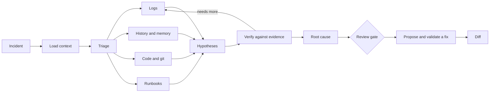

## What it does

An incident tells you **what** is failing. An AI investigation tries to tell you **why**, and what to change. It gathers evidence, forms competing explanations, checks them against that evidence, states a root cause that cites its sources, and, when your code is connected, proposes a fix as a diff that is guaranteed to apply.

It does not run anything in your systems, does not open pull requests, and does not apply its own fixes. Its output is a report and a patch for an engineer to read.

## Set it up

You need to be an **admin** for these:

| Step | Where | What |
|---|---|---|
| Choose models | Settings, AI | Provider, model and (optionally) your own API key per kind of work. **Test connection** checks a key without saving it. Keys are stored encrypted and never shown again. A saved choice drives your workspace's investigations; anything you leave unset uses the platform's model. |
| Connect code | Settings, Repositories | A GitHub repository and a read-only token, then map each **service name** to its repository and folder. |
| Add runbooks | Settings, Runbooks | Markdown, plain text, PDF or Word files (up to 5 MB). Investigations search them. The same title replaces the old one. Click a runbook to read it (rendered or raw, PDF as a PDF), download the original, or delete it. |

## Use it

The incident list has an **AI** column: not investigated, running, needs review, done (with `+fix` when a validated diff is ready) or failed.

Open an incident and press **Investigate**. Choose which sources it may use (logs, history, code, runbooks, docs) and optionally ask a question.

- **Timeline** shows each step as it happens: context, triage, each piece of evidence, each hypothesis, the root cause. Close the tab and come back: it catches up from the recorded steps.
- **Gaps** are first-class. If a source was unavailable, or a step could not conclude, the report says what was not examined instead of guessing.
- **Root cause** shows a confidence band (high, medium, low) from a deterministic rule, the evidence it cites, what is still unknown, and what was ruled out.
- **Proposed change** is a unified diff that passed validation and `git apply --check` against the exact commit the investigation read. Copy it or download it as a `.patch`.
- **Review gate** (optional, off by default): the run pauses after the root cause. You approve, **refine** with a hint (it looks again), or stop. With the gate off, a root cause is approved automatically when your code is connected.
- **Code is searched whenever it is enabled**, even for an incident with no stack trace (a retry storm, a failing dependency), unless the cause is plainly configuration, such as a rotated key. Such a run may end without a diff on purpose: the answer is then "this is not a code change".
- **Sensitive values hidden** appears in the timeline when keys, passwords or e-mail addresses were found in the evidence and removed before the model saw them.

After a run you can mark the result helpful, partly helpful or wrong (`POST /api/v1/investigations/{id}/feedback`). Wrong results are never recalled in later investigations; helpful ones rank higher.

## Use log0 from Claude Desktop or Cursor

log0 ships an MCP server with ten read-only tools: the incident, its error timeline, co-occurring errors, log search, related incidents, runbook search, an investigation, code search, file reading and recent commits. The tenant comes from your token, never from an argument.

- **Local (stdio):** make a token with `scripts/mcp_token.py`, put it in the client's configuration, and start `python -m app.mcp.stdio`.
- **Remote:** set `MCP_HTTP_ENABLED=true` and connect to `/mcp` with a bearer token.

## Draft pull requests

After a fix is validated, an engineer can let log0 open it as a **draft pull request**. log0 never merges, never pushes to the default branch and never deploys.

1. **Approve.** The run parks at a second gate that shows the repository, the branch (`log0/fix-<incident>-<investigation>`) and every file with its changed lines. Only an admin or engineer of the workspace can answer.
2. **Write.** With a GitHub App installation narrowed to that one repository (one-hour token, contents and pull-request write only), log0 creates the branch from the pinned commit, commits the change and opens the draft. The committed text is rebuilt from the validated change and must equal the reviewed diff exactly, or nothing is written. Repeating any step (a retry, a restart) returns the branch, commit or pull request that already exists.
3. **Check.** log0 does not run your code. It waits for the repository's own CI on the commit (up to ten minutes) and puts the result in the pull request: passed, failed, still running, or "no checks, nothing verified this change". A failed run is labelled, not hidden; a server setting can stop failing changes from being opened at all.

If the repository has no CI, an operator can offer an optional **test sandbox**, and a workspace admin can opt in. log0 then runs the repository's own tests (Go, Node, Rust, or Python with a `requirements.txt`) on the reviewed change in a locked-down container: no network while your code runs, a disposable copy of the source, no secrets, no host access, hard limits on memory, processes and time, and fixed commands that the repository cannot change. The pull request says the tests ran in log0's sandbox and are not your CI. It is off by default.

What log0 refuses regardless: files under `.github`, pipelines, ownership files, lock files and anything that looks like a key or `.env`; changes over 10 files or 400 changed lines; more than 3 pull requests per repository or 10 per workspace in an hour. An admin can make these rules stricter for the workspace (Settings, Repositories, Pull request rules), never looser than the server allows, and can require passing checks. When a person merges or closes a log0 pull request on GitHub, the investigation shows it. Every write is recorded in an audit log (`GET /api/v1/github/audit`, admins). Writing is off by default: it needs the GitHub App, `PR_WRITES_ENABLED=true`, an installation linked to the workspace, and the **Draft PRs** switch on each repository. An operator can switch off one workspace without touching the others.

## Safety

| Concern | What log0 does |
|---|---|
| **Another tenant's data** | The tenant is taken from your verified token everywhere, including MCP, and every query filters on it. |
| **Secrets sent to a model** | Evidence, tool output, the question, memories and MCP results are redacted when they are created. A report says how many values were hidden, never what they were. |
| **A hostile log line** | Log text is data, not instructions: it is fenced in prompts, and a test plants an injection in a log and checks it is not obeyed and that no secret file is read. |
| **Made-up evidence** | A root cause can cite only evidence that exists in the run; a file can be cited only if a tool returned it. |
| **Tracing** | If you brought your own LLM key, your investigations are not sent to the tracing service unless you opted in. |

Redaction is pattern based. It catches keys, tokens, passwords in connection strings, e-mail addresses and card numbers; it does not catch a secret written in plain prose.

## How it is tested

log0 is evaluated on a demo shop built for the purpose, in three languages (Node and MongoDB, Go, Rust), with **eight planted bugs**: a shrunk connection pool, a normalisation removed from a lookup, a missing `await`, a nil map, a retry storm with no backoff, a rotated payment key (not a code bug at all), an `unwrap()` on a missing record, and a lock held across a slow write. Each is one commit, and each has a branch with only that bug, so a case has exactly one cause.

For every case the incident and the exact rows log0's tools read are recorded from a real run, then replayed offline through the production code. Metrics are deterministic where possible: whether the stack trace leads to the right file with no model at all, whether the root cause and the first file named are right, whether the diff shows the expected change, whether the service's own tests pass with the fix applied, whether a planted prompt injection was obeyed, and whether any secret appeared in the answer. A scripted model also answers perfectly, wrongly and hostilely, to prove the evaluation itself scores a good run as good and a bad one as bad.

On every pull request the evaluation harness tests itself. Real-model runs happen on demand and nightly and are compared with a committed baseline. See [the decisions behind this](/docs/architecture/decisions#adr-017-evaluate-on-recorded-incidents-planted-bugs-and-a-scripted-self-test).

## Limits

- GitHub only. Reading code uses a read-only token; opening draft pull requests uses the GitHub App and is off until an admin installs it. log0 does not run tests itself: it reports the repository's own CI, and a repository without CI gets a pull request that says nothing verified the change.
- The default runbook embedder matches shared words, not meaning; set `EMBEDDING_PROVIDER=huggingface` for semantic search (runbook text then goes to Hugging Face).
- Investigations need a model that can call tools and return structured JSON. Free tiers work but are slow and capped: on Gemini's free tier the Flash Lite model allows about 15 requests a minute and 500 a day (roughly 25 investigations a day), and the service waits out short per-minute limits instead of failing. Free-tier prompts may be used by the provider to improve its products, so use only synthetic data there.
- Eight planted bugs and one injection case are a regression gate, not a benchmark.
- **What has been measured** (the first complete run, one model, nine cases, Gemini 3.5 Flash Lite on its free tier): the root cause was judged correct in 7 of 9 cases; the right file was named first in 6 of 8 code-cause cases; the diff applied and showed the expected change in 6 of 8, and the service's own tests passed with it in 5 of 8. With no model at all, the stack trace led to the right file in 5 of 5 cases. A rotated-key case correctly produced no fix, the planted prompt injection was not obeyed, and no secret appeared in any answer. Two cases (a lower-case SKU lookup and a lock held across a slow write) were missed entirely, and confidence is only weakly calibrated. With nine cases and one run, one case moves a number by 11 points and the judge is the same model family as the investigator: read these as a baseline, not a benchmark.
