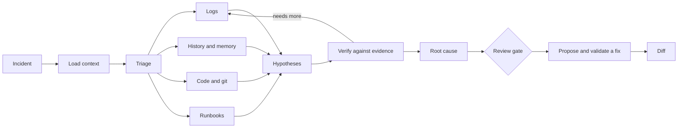

## What it does

An incident tells you **what** is failing. An AI investigation tries to tell you **why**, and what to change. It gathers evidence, forms competing explanations, checks them against that evidence, states a root cause that cites its sources, and, when your code is connected, proposes a fix as a diff that is guaranteed to apply.

It does not run anything in your systems, does not open pull requests, and does not apply its own fixes. Its output is a report and a patch for an engineer to read.

## Set it up

You need to be an **admin** for these:

| Step | Where | What |
|---|---|---|
| Choose models | Settings, AI | Provider, model and (optionally) your own API key per kind of work. **Test connection** checks a key without saving it. Keys are stored encrypted and never shown again. |
| Connect code | Settings, Repositories | A GitHub repository and a read-only token, then map each **service name** to its repository and folder. |
| Add runbooks | `POST /api/v1/runbooks` | Markdown runbooks; investigations search them. Uploading the same title replaces it. |

## Use it

Open an incident and press **Investigate**. Choose which sources it may use (logs, history, code, runbooks, docs) and optionally ask a question.

- **Timeline** shows each step as it happens: context, triage, each piece of evidence, each hypothesis, the root cause. Close the tab and come back: it catches up from the recorded steps.
- **Gaps** are first-class. If a source was unavailable, or a step could not conclude, the report says what was not examined instead of guessing.
- **Root cause** shows a confidence band (high, medium, low) from a deterministic rule, the evidence it cites, what is still unknown, and what was ruled out.
- **Proposed change** is a unified diff that passed validation and `git apply --check` against the exact commit the investigation read. Copy it or download it as a `.patch`.
- **Review gate** (optional, off by default): the run pauses after the root cause. You approve, **refine** with a hint (it looks again), or stop. With the gate off, a root cause is approved automatically when your code is connected.
- **Sensitive values hidden** appears in the timeline when keys, passwords or e-mail addresses were found in the evidence and removed before the model saw them.

After a run you can mark the result helpful, partly helpful or wrong (`POST /api/v1/investigations/{id}/feedback`). Wrong results are never recalled in later investigations; helpful ones rank higher.

## Use log0 from Claude Desktop or Cursor

log0 ships an MCP server with ten read-only tools: the incident, its error timeline, co-occurring errors, log search, related incidents, runbook search, an investigation, code search, file reading and recent commits. The tenant comes from your token, never from an argument.

- **Local (stdio):** make a token with `scripts/mcp_token.py`, put it in the client's configuration, and start `python -m app.mcp.stdio`.
- **Remote:** set `MCP_HTTP_ENABLED=true` and connect to `/mcp` with a bearer token.

## Safety

| Concern | What log0 does |
|---|---|
| **Another tenant's data** | The tenant is taken from your verified token everywhere, including MCP, and every query filters on it. |
| **Secrets sent to a model** | Evidence, tool output, the question, memories and MCP results are redacted when they are created. A report says how many values were hidden, never what they were. |
| **A hostile log line** | Log text is data, not instructions: it is fenced in prompts, and a test plants an injection in a log and checks it is not obeyed and that no secret file is read. |
| **Made-up evidence** | A root cause can cite only evidence that exists in the run; a file can be cited only if a tool returned it. |
| **Tracing** | If you brought your own LLM key, your investigations are not sent to the tracing service unless you opted in. |

Redaction is pattern based. It catches keys, tokens, passwords in connection strings, e-mail addresses and card numbers; it does not catch a secret written in plain prose.

## How it is tested

log0 is evaluated on a demo shop built for the purpose, in three languages (Node and MongoDB, Go, Rust), with **eight planted bugs**: a shrunk connection pool, a normalisation removed from a lookup, a missing `await`, a nil map, a retry storm with no backoff, a rotated payment key (not a code bug at all), an `unwrap()` on a missing record, and a lock held across a slow write. Each is one commit, and each has a branch with only that bug, so a case has exactly one cause.

For every case the incident and the exact rows log0's tools read are recorded from a real run, then replayed offline through the production code. Metrics are deterministic where possible: whether the stack trace leads to the right file with no model at all, whether the root cause and the first file named are right, whether the diff shows the expected change, whether the service's own tests pass with the fix applied, whether a planted prompt injection was obeyed, and whether any secret appeared in the answer. A scripted model also answers perfectly, wrongly and hostilely, to prove the evaluation itself scores a good run as good and a bad one as bad.

On every pull request the evaluation harness tests itself. Real-model runs happen on demand and nightly and are compared with a committed baseline. See [the decisions behind this](/docs/architecture/decisions#adr-017-evaluate-on-recorded-incidents-planted-bugs-and-a-scripted-self-test).

## Limits

- GitHub only, with a personal access token. No branches or pull requests are created.
- The default runbook embedder matches shared words, not meaning; set `EMBEDDING_PROVIDER=huggingface` for semantic search (runbook text then goes to Hugging Face).
- Saved AI settings are stored and testable per workspace; runs use the platform models until the per-workspace model selection is wired into the investigation.
- Eight planted bugs and one injection case are a regression gate, not a benchmark. Quality numbers come from a real-model run and are published only when one has been done.
