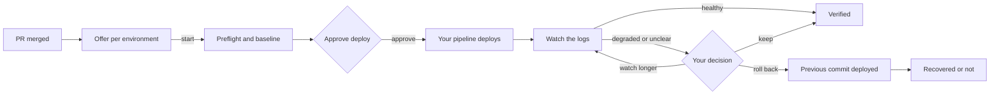

## What it does

A merged fix is not a finished fix. **Controlled deploys** close the loop: after a person merges a log0 pull request, log0 can offer to ship it, watch the logs, say whether the error actually went away, and, if it did not, put the previous commit back.

It is built to be boring and safe:

- **Merge is not consent to deploy.** A merge only creates an *offer* for each environment you listed. Nothing starts until a person with the right role starts it and then approves it.
- **log0 holds no cloud credentials.** It asks *your* deploy workflow to run (a GitHub Actions `workflow_dispatch`) with exactly three inputs: the commit, the environment name and a correlation id. Your pipeline already knows how to deploy; log0 never learns how.
- **The verdict is arithmetic, not a model.** Did the error rate fall? Did a new error appear? Was there enough traffic to tell? Counting cannot be talked into "looks fine" by a log line.
- **A person decides what to do about a bad result.** Keep it, watch longer, or roll back. Rolling back is a person's choice; there is no automatic rollback.



## Set it up

1. **Give the GitHub App more permissions.** Deploying needs *Actions: write* and *Deployments: write* on top of the pull request permissions. GitHub makes every installation approve a new permission once; **Settings, Repositories, Deploys** shows which ones are still missing.
2. **Write a deploy workflow** in the repository. It must accept the inputs `sha`, `environment` and `correlation_id`, put the correlation id in its `run-name` (so log0 can find its own run), and check out `inputs.sha`.

   ```yaml
   name: deploy
   run-name: deploy ${{ inputs.environment }} ${{ inputs.sha }} ${{ inputs.correlation_id }}
   on:
     workflow_dispatch:
       inputs:
         sha: { required: true }
         environment: { required: true }
         correlation_id: { required: true }
   ```

3. **Describe the deploy** in **Settings, Repositories, Deploys** (admins): the workflow file, and up to five environments in promotion order. Each has an On/Off switch (off means no deploys are offered there), who may approve (an admin; engineers too for non-production), whether the previous environment must have verified the change first, how long to watch the logs, a timeout, the minimum traffic needed to judge, the margin, and freeze windows (hours in UTC when nothing deploys).
4. **An operator turns deploys on** for the server (`DEPLOYS_ENABLED=true`, off by default). A workspace can also be switched off without touching the others.

## Use it

1. **Merge the pull request.** The **Fix** tab shows a card per environment: *Ready to deploy*.
2. **Review and deploy.** log0 checks the rules (switches, freeze windows, the repository's checks on the merge commit, no other deploy running there, the hourly limit, no database migrations in the change) and captures a **baseline**: how often the error happened in the half hour before, how much traffic, which other errors were present. If something is refused, the card says why and the offer stays.
3. **Approve.** The approval shows the commit, the commit it would go back to, and the baseline. An admin approves production; an engineer may approve non-production if the environment allows it.
4. **Watch.** log0 starts your workflow, follows the run, then waits out a short grace period (restarts and warm-up are not judged) and looks at the logs through the soak window.
5. **Verdict.** *Healthy*: the error clearly fell and nothing new appeared. *Degraded*: it got worse, or a new error grew (this can end the watch early after five minutes of data). *Unclear*: not clearly better or worse, or too little traffic. For the last two a person chooses **Keep it**, **Watch longer** (twice at most) or **Roll back to `abc1234`**.
6. **Rollback.** log0 deploys the commit that ran before, through the same workflow, once. It then judges whether the service is back to where it was: recovered, not recovered (the remediation ends *Failed*, loudly: log0 has nothing left to try), or unconfirmed when there was too little traffic to tell.

The incident list marks the latest deploy of a fix: *deployed*, *rolled back*, *deploying* or *deploy failed*.

## Safety

| Concern | What log0 does |
|---|---|
| **Deploying without consent** | A merge creates an offer only. A person starts it and a person with the right role approves it; every answer is recorded with who, which role and which commit. Repeating an approval changes nothing. |
| **Arbitrary commands** | The workflow file is a plain file name; the inputs are a 40-character commit, a lowercase environment name and a UUID, each checked by a pattern before dispatch. The configuration has no free text and no commands. |
| **Cloud credentials** | None. log0 holds only a short-lived GitHub token with Actions and Deployments write for this one repository. |
| **Two deploys at once** | One active deploy per repository and environment, enforced by the database. |
| **Deploying a database change** | A change that touches migrations is not eligible. |
| **Double dispatch after a crash** | The run is looked up again by its correlation id before anything is dispatched a second time; a run that never appears fails the remediation instead of guessing. |
| **A rollback that loops** | There is no path from a rollback back to a verdict gate, the status machine has no way out of its end states, and the table allows one rollback row. |
| **A false "healthy"** | Too little traffic is never healthy ("silence" can mean fixed or dead). A log store that cannot be read at the end gives *unclear*, never *healthy*. |
| **Rewriting history** | The audit table rejects updates, deletes and truncates in the database itself; details are redacted before they are stored. Admins read it at `GET /api/v1/remediations/audit`. |
| **Kill switches** | Server (`DEPLOYS_ENABLED`), per workspace (`DEPLOYS_DISABLED_TENANTS`), per environment (the On/Off switch). They also stop a rollback: if deploys are off, log0 does nothing and says to roll back by hand. |

## Limits

- GitHub Actions only. Your workflow must follow the contract above.
- The verdict looks at one error and the service's other errors in your logs. It does not measure latency, saturation or business metrics.
- The thresholds (margin 50%, 100 log lines, 5 new errors a minute) are conservative defaults, not tuned numbers.
- No automatic rollback. The configuration has a field for it, but nothing honours it, so the console does not offer it.
- Nothing here has been measured on a long-running production system yet; see the [roadmap](/docs/roadmap).
